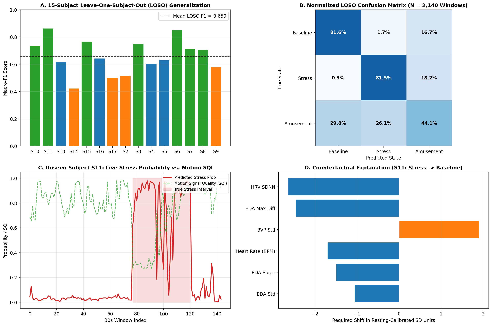

# Motion-Artifact-Aware & Zero-Shot Calibrated Stress Detection

### Wrist-only Empatica E4 signals · WESAD · 15-subject LOSO evaluation

[](https://www.python.org/)
[](https://pytorch.org/)
[](https://colab.research.google.com/drive/1F5PR5qAale2RXWGzsKVGAan7MENQchvG)

A wearable affect recognition project that combines physiological baseline calibration, accelerometer-derived signal quality, and a multimodal neural network to classify **Baseline**, **Stress**, and **Amusement** from WESAD wrist recordings.

The [Colab notebook](https://colab.research.google.com/drive/1F5PR5qAale2RXWGzsKVGAan7MENQchvG) implements dataset exploration, signal preprocessing, window extraction, calibrated and uncalibrated tabular benchmarks, 15-fold leave-one-subject-out (LOSO) neural-network training, counterfactual feature optimization, and deployment artifact export. A [local notebook copy with saved outputs](notebooks/wesad_sqi_multimodal_loso.ipynb) is included. The same pipeline is available as reusable Python modules and local CLI commands; the dashboard runs calibrated inference on actual recorded windows.

**Saved notebook results:** pooled out-of-fold Macro-F1 **0.6851**, balanced accuracy **0.6908**, and mean per-subject Macro-F1 **0.6587 ± 0.1220**, across **2,140 windows from 15 participants**.



## Contents

- [Research workflow](#research-workflow)
- [Dataset and signal processing](#dataset-and-signal-processing)
- [Zero-shot baseline calibration](#zero-shot-baseline-calibration)
- [Model architecture and training](#model-architecture-and-training)
- [Experimental results](#experimental-results)
- [Counterfactual explanations](#counterfactual-explanations)
- [Running the research notebook](#running-the-research-notebook)
- [Running the local research pipeline](#running-the-local-research-pipeline)
- [Running the dashboard and prediction CLI](#running-the-dashboard-and-prediction-cli)
- [Repository structure](#repository-structure)
- [Evaluation considerations](#evaluation-considerations)
- [Software checks](#software-checks)

## Research workflow

The notebook completes eight stages, in execution order:

| Stage | Work performed | Output |
| --- | --- | --- |
| 1. Dataset acquisition | Download WESAD through `kagglehub` and inspect subject files. | Dataset directory listing. |
| 2. Signal exploration | Load S2, inspect sampling rates and protocol labels, and plot wrist recordings. | Four-panel session visualization. |
| 3. Preprocessing | Filter signals, extract windows, build six-channel sequences and 18 features, and audit motion SQI by class. | `wesad_windows.npz`, `wesad_meta.csv`. |
| 4. Tabular benchmarks | Compare raw features with resting-calibrated features using HistGradientBoosting and subject-held-out evaluation. | Pooled metrics, per-subject summaries, classification report. |
| 5. Neural-network evaluation | Train an SQI-gated multimodal CNN separately for each held-out subject. | `wesad_loso_results.npz`, 15 fold scores, classification report. |
| 6. Explainability and diagnostics | Train an S11-held-out reference model, optimize a Stress-to-Baseline feature perturbation, and plot diagnostics. | Counterfactual output and `wesad_loso_diagnostics.png`. |
| 7. Model export | Save the reference model's CPU weights, scaler statistics, class labels, and configuration. | `wesad_bundle.joblib`. |
| 8. App packaging | Generate a Streamlit application and bundle deployment files. | `wesad_deployment_package.zip`. |

The local implementation extracts this workflow into reusable preprocessing, calibration, training, evaluation, explainability, visualization, and inference modules. The notebook preserves the original research code and saved results. Historical metrics in the dashboard are extracted from those saved outputs by `scripts/import_notebook_results.py`; new local runs write separate results under `outputs/`.

## Dataset and signal processing

### Data used

The notebook downloads `orvile/wesad-wearable-stress-affect-detection-dataset` through KaggleHub and uses **only the wrist signals** from the subject pickle files. Chest recordings are not model inputs.

The processed participants are **S2, S3, S4, S5, S6, S7, S8, S9, S10, S11, S13, S14, S15, S16, and S17**.

| Signal | Native sampling rate | Processing in the notebook |
| --- | ---: | --- |
| Blood volume pulse (BVP) | 64 Hz | Third-order Butterworth bandpass, 0.7–3.5 Hz, applied with `filtfilt`; peak-based HR/HRV features. |
| Electrodermal activity (EDA) | 4 Hz | Second-order Butterworth low-pass at 0.5 Hz, applied with `filtfilt`. |
| Skin temperature (TEMP) | 4 Hz | Window statistics and temperature change per minute. |
| Three-axis accelerometer (ACC) | 32 Hz | Vector-magnitude statistics, motion SQI, and per-axis sequence inputs. |
| Protocol labels | 700 Hz | Dominant-label selection and window-purity check. |

Labels `1`, `2`, and `3` are mapped to **Baseline**, **Stress**, and **Amusement**. Other protocol states, including meditation and transitions, are excluded.

### Window extraction

- Window duration: **30 seconds**.
- Stride: **15 seconds**, giving 50% overlap.
- Acceptance: a target class must occupy at least **90%** of the window's label samples.
- Sequence representation: BVP is block-averaged in groups of 16 samples and each ACC axis in groups of 8 samples, producing six channels at 4 Hz.
- Final arrays: **`X_seq.shape = (2140, 6, 120)`** and **`X_feat.shape = (2140, 18)`**.

| Class | Retained windows |
| --- | ---: |
| Baseline | 1,149 |
| Stress | 642 |
| Amusement | 349 |
| **Total** | **2,140** |

### Physiological and motion features

| Indices | Features | Implementation details |
| --- | --- | --- |
| 0–3 | BPM, SDNN, RMSSD, BVP standard deviation | BVP peaks use a minimum spacing of `int(0.4 × 64)` samples and prominence `0.4 × std(BVP)`. Fewer than four peaks triggers fallback values of 75 BPM, 40 SDNN, and 30 RMSSD. |
| 4–8 | EDA mean, standard deviation, net change, rise-count proxy, maximum first difference | The variable named `scr_peaks` counts successive differences above `0.01`; it is a rise-count proxy rather than a separate SCR peak detector. |
| 9–11 | Temperature mean, standard deviation, slope | Slope is the endpoint difference divided by window duration in minutes. |
| 12–14 | ACC magnitude mean, standard deviation, range | Computed from native-rate vector magnitude. |
| 15 | Motion SQI | `exp(-0.08 × std(ACC magnitude))`. |
| 16–17 | BPM × SQI, RMSSD × SQI | Quality-weighted physiological features. |

### Motion quality audit

The extracted windows produced the following average SQI values:

| State | Mean SQI |
| --- | ---: |
| Amusement | 0.932 |
| Baseline | 0.874 |
| Stress | 0.754 |

Stress windows have lower average motion SQI in this run, motivating the use of motion context in the model. This association does not itself establish the cause of signal corruption or isolate the benefit of gating.

## Zero-shot baseline calibration

For each participant, the notebook selects the **first three retained Baseline windows** as a resting reference. Physiological features are transformed using:

```text
calibrated_feature = (feature - resting_mean) / (resting_std + 1e-4)
```

For the tabular benchmark, calibration is applied to feature columns `0:12`; columns `12:18` remain unchanged.

For the neural network:

1. BVP, EDA, and TEMP sequences are calibrated using resting statistics aggregated across the selected windows and time samples.
2. Each ACC axis is standardized separately within each window.
3. Physiological feature columns `0:12` are resting-calibrated.
4. Both the entire sequence tensor and the entire 18-feature matrix are clipped to **[-10, 10]**.
5. Feature means and standard deviations are then fitted on the **training participants of each LOSO fold**, using an additional `1e-5` in the feature scale denominator.

“Zero-shot” here refers to using the held-out person's resting reference without fitting classifier weights on that person. It assumes a known resting onboarding period; the notebook selects it using protocol Baseline labels.

## Model architecture and training

### SQIGatedMultimodalNet

The network contains **41,827 trainable parameters**. It fuses a 128-dimensional temporal representation with a 64-dimensional physiological feature representation.

```text
Six-channel sequence [B, 6, 120]
    ├── Fast CNN: Conv(k=3) → Conv(k=3) ──> 64 features ──┐
    └── Slow CNN: Conv(k=11) → Conv(k=7) ─> 64 features ──┴─> 128 temporal features
                                                                  │
Motion features [B, 4] → Linear(4, 32) → GELU → Linear(32, 128) → Sigmoid
                                                                  │ elementwise gate
                                                                  v
                                                        Gated temporal embedding
                                                                  │
Physiological/motion features [B, 18] → Linear(18, 64) → LayerNorm ───┤
                                                                  v
                                                      Concatenation [B, 192]
                                                                  │
                                                    Classifier: 192 → 64 → 3
                                                                  │
                                                     Baseline / Stress / Amusement
```

The motion gate uses feature columns `12:16`: ACC magnitude mean, standard deviation, range, and SQI after preprocessing. Temporal branches use batch normalization, GELU, max pooling, and adaptive average pooling. The feature branch uses GELU and dropout `0.25`; the classifier uses GELU and dropout `0.3`.

### Training configuration

| Setting | Notebook configuration |
| --- | --- |
| Evaluation | 15 LOSO folds, one participant held out per fold. |
| Epochs | 25 per fold. |
| Batch sizes | 64 for training, 128 for testing. |
| Optimizer | AdamW, learning rate `1.5e-3`, weight decay `1e-3`. |
| Loss | Cross-entropy with inverse-frequency class weights and label smoothing `0.05`. |
| Initialization | NumPy and PyTorch seeds set to `42` before the fold loop. |
| Device | CUDA when available; the saved evaluation ran on CPU. |
| Saved run duration | 554.8 seconds for the 15-fold neural-network evaluation. |

The tabular comparator is `HistGradientBoostingClassifier` with 150 iterations, learning rate `0.05`, maximum depth `5`, L2 regularization `1.0`, balanced class weights, and random state `42`.

## Experimental results

These values come from the notebook's saved execution outputs. They were inspected alongside the code; training was not rerun during repository preparation.

### Pipeline comparison

| Pipeline | Pooled Macro-F1 | Balanced accuracy | Mean subject Macro-F1 ± SD |
| --- | ---: | ---: | ---: |
| Uncalibrated tabular features | 0.6225 | 0.6261 | 0.5744 ± 0.0864 |
| Resting-calibrated tabular features | 0.6652 | 0.6614 | 0.6236 ± 0.1303 |
| Calibrated SQI-gated CNN + feature fusion | **0.6851** | **0.6908** | **0.6587 ± 0.1220** |

Resting calibration improves the tabular model's pooled Macro-F1 by **0.0427**. The neural pipeline adds **0.0199** over the calibrated tabular comparator. Because this comparison changes both architecture and sequence inputs, it does not measure the isolated effect of SQI gating; there is no otherwise-identical ungated CNN ablation in this notebook.

**Why the figure shows 0.659:** pooled Macro-F1 is calculated once from all 2,140 out-of-fold predictions. Mean subject Macro-F1 averages the 15 individual subject scores. Panel A rounds the latter value, **0.6587**, to **0.659**.

### Neural-network classification report

| State | Precision | Recall | F1-score | Support |
| --- | ---: | ---: | ---: | ---: |
| Baseline | 0.8985 | 0.8164 | 0.8554 | 1,149 |
| Stress | 0.8262 | 0.8146 | 0.8204 | 642 |
| Amusement | 0.3326 | 0.4413 | 0.3793 | 349 |
| Macro average | 0.6858 | 0.6908 | 0.6851 | 2,140 |
| Weighted average | 0.7845 | 0.7547 | 0.7673 | 2,140 |

Overall accuracy is **0.7547**. The normalized confusion matrix shows approximately **0.3%** of Stress windows predicted as Baseline; approximately **18.2%** are predicted as Amusement. Amusement remains the weakest class.

### Per-subject LOSO Macro-F1

| Subject | Macro-F1 | Subject | Macro-F1 | Subject | Macro-F1 |
| --- | ---: | --- | ---: | --- | ---: |
| S10 | 0.7352 | S16 | 0.6422 | S5 | 0.6285 |
| S11 | 0.8619 | S17 | 0.4985 | S6 | 0.8496 |
| S13 | 0.6157 | S2 | 0.5144 | S7 | 0.7106 |
| S14 | 0.4221 | S3 | 0.7499 | S8 | 0.7048 |
| S15 | 0.7653 | S4 | 0.6032 | S9 | 0.5783 |

## Counterfactual explanations

The notebook trains a separate reference model excluding **S11**, then selects the sixth retained S11 Stress window. It keeps the sequence input fixed and optimizes the first 12 standardized physiological features toward the Baseline class, resetting feature columns `12:18` to their original values after every update.

Optimization uses Adam with learning rate `0.05` for **120 steps**:

```text
loss = cross_entropy(prediction, Baseline)
       + 0.15 × mean(abs(changed_physiological_features - original_features))
```

| Output | Original window | Counterfactual feature vector |
| --- | ---: | ---: |
| Stress score | 98.2% | 22.9% |
| Baseline score | 0.3% | 55.0% |

The six largest feature changes in the saved output are:

| Feature | Optimized change |
| --- | ---: |
| HRV SDNN | -2.64 |
| EDA maximum first difference | -2.45 |
| BVP standard deviation | +1.91 |
| Heart rate | -1.70 |
| EDA net change | -1.49 |
| EDA standard deviation | -1.05 |

These deltas are computed in the **fold-standardized feature space**, following resting calibration. The notebook figure describes them as resting-calibrated SD units, but they are not direct raw-unit changes or solely resting-standard-deviation changes. The optimization finds a model-specific perturbation with an L1 penalty; it does not prove global minimality, physiological feasibility, or causality.

### Diagnostic figure

- **Panel A:** Macro-F1 for each held-out subject and their mean.
- **Panel B:** Row-normalized confusion matrix from all out-of-fold predictions.
- **Panel C:** Recorded S11 out-of-fold Stress scores and motion SQI over the retained windows. This is an offline timeline, not a live device stream.
- **Panel D:** The six largest optimized feature shifts from the separately trained S11-held-out reference model.

## Running the research notebook

Open the [original Colab notebook](https://colab.research.google.com/drive/1F5PR5qAale2RXWGzsKVGAan7MENQchvG), or upload [the included notebook](notebooks/wesad_sqi_multimodal_loso.ipynb) to Colab. Run its cells sequentially in a fresh session.

Install the research dependencies in a Colab setup cell if needed:

```python
%pip install kagglehub numpy pandas scipy scikit-learn matplotlib torch joblib
```

The shared research and application dependencies are listed in [requirements.txt](requirements.txt); [requirements-notebook.txt](requirements-notebook.txt) additionally includes KaggleHub. The notebook uses `google.colab.files` for downloads, so its export cells are intended for Colab.

1. Run the acquisition cell to obtain `dataset_path` through KaggleHub. Complete any dataset access or authentication steps required by Kaggle.
2. In the exploration and preprocessing cells, replace the saved `DATA_DIR` assignment with the path for your runtime:

   ```python
   DATA_DIR = os.path.join(dataset_path, "WESAD")
   ```

   The original notebook contains a hardcoded `/kaggle/input/.../WESAD` path, which may differ in a fresh Colab session.

3. Run extraction, both tabular benchmarks, neural LOSO training, diagnostics, and export in order. Later cells depend on arrays, functions, and the network class defined earlier.
4. Keep the generated `/content/` outputs before ending the Colab session.

| Generated file under `/content/` | Contents |
| --- | --- |
| `wesad_windows.npz` | Raw window sequence and feature arrays. |
| `wesad_meta.csv` | Subject, start time, label, state, SQI, BPM, mean EDA, and mean temperature. |
| `wesad_loso_results.npz` | Out-of-fold scores, predictions, true labels, and subject IDs. |
| `wesad_loso_diagnostics.png` | Four-panel research visualization. |
| `wesad_bundle.joblib` | CPU model weights, `f_mu`, `f_sd`, classes, and model configuration. |
| `wesad_deployment_package.zip` | Original generated Streamlit deployment package. |

The source notebook and saved outputs are included. Raw participant recordings and the generated window, metadata, and prediction arrays are not currently included. Exact numerical reproduction can depend on library versions, runtime, and device; the original notebook does not pin its environment or enable deterministic PyTorch algorithms.

### Exported model provenance

The export cell saves the `model`, `f_mu`, and `f_sd` left by the **S11-held-out reference-model cell**. It does not retrain a final deployment model on all 15 participants. The bundle contains one model, not the collection of 15 LOSO models, and does not include individual resting calibration statistics.

To update the dashboard after a research run, copy the trusted exported bundle into `models/wesad_bundle.joblib` and the figure into `assets/wesad_loso_diagnostics.png`. Joblib uses pickle internally; loading an untrusted bundle can execute code.

## Running the local research pipeline

Use Python 3.10 or newer. From the repository root, create an environment:

```bash
python -m venv .venv
```

```bash
# Linux / macOS
source .venv/bin/activate
```

```powershell
# Windows PowerShell
.venv\Scripts\Activate.ps1
```

Install the shared research and application dependencies:

```bash
python -m pip install -r requirements.txt
```

For dataset downloading through KaggleHub, also install:

```bash
python -m pip install -r requirements-notebook.txt
```

On Linux or Windows, install CPU-only PyTorch before the requirements to reduce the download size:

```bash
python -m pip install torch --index-url https://download.pytorch.org/whl/cpu
python -m pip install -r requirements.txt
```

On macOS, use the regular requirements installation. In VS Code, select this environment's interpreter. The local project was checked with Python 3.13.9, Streamlit 1.51.0, PyTorch 2.12.0+cpu, NumPy 2.3.5, pandas 2.3.3, and joblib 1.5.2.

### 1. Acquire and inspect WESAD

```bash
python -m stress_detection download
```

The command prints the downloaded dataset location. Complete any access/authentication steps required by Kaggle, then pass the WESAD directory or its parent to preparation. Existing local dataset copies can be used directly.

```bash
python -m stress_detection inspect --recording /path/to/WESAD/S2/S2.pkl --output outputs/S2_signals.png
python -m stress_detection prepare --data-dir /path/to/WESAD --output-dir data/processed
```

Preparation reads original **trusted local WESAD pickle files**, applies the notebook's filters, and saves `data/processed/wesad_windows.npz` and `data/processed/wesad_meta.csv`. The original pickle format can execute code when loaded; do not use untrusted recordings. The web application accepts NPZ/CSV window exports rather than pickle uploads.

### 2. Run both tabular benchmarks

```bash
python -m stress_detection benchmark --output outputs/tabular_metrics.json
```

This evaluates raw and resting-calibrated features with the notebook's HistGradientBoosting settings, holding out one participant at a time.

New `benchmark` and `evaluate` runs score only windows starting after the end of
the participant's first three resting-reference windows. Overlapping windows are
excluded too: with starts at 0, 15 and 30 seconds, scoring starts at 60 seconds,
not at the fourth window. Predictions are retained for every window, while JSON
and NPZ reports record an explicit `evaluation_mask`, excluded counts and the
protocol name. Diagnostic metrics use this same mask.

The historical scores above include onboarding and remain unchanged. To reproduce
that scoring explicitly, pass `--include-onboarding` to `benchmark` or `evaluate`.
Post-onboarding results require a new run and must not be substituted into the
historical table. Training/calibration formulas and existing model compatibility
are unchanged; full-recording filtering remains offline.

### 3. Train and evaluate the neural network with LOSO

```bash
python -m stress_detection evaluate --device cpu --output-dir outputs/loso
```

Defaults match the notebook: 25 epochs, batch size 64, seed 42. A fresh model and training-only feature scaler are fitted in every fold. Outputs include `wesad_loso_results.npz` and `metrics.json`, containing the pooled report, per-subject scores, fold membership, and training configuration.

The number of folds follows the supplied dataset; it is 15 only when all 15 participants are provided. Use `--epochs 1` only for a software smoke check, not for reproducing the reported experiment. `--device auto` selects CUDA when available.

### 4. Train and export a reference model

```bash
python -m stress_detection train --holdout S11 --device cpu --output outputs/reference_model.joblib
```

This matches the notebook's separate S11-held-out reference-model stage. Its bundle includes model weights, feature scaler, class order, training settings, and subject provenance. The historical bundled model is preserved unless explicitly replaced.

An optional all-subject deployment fit is available:

```bash
python -m stress_detection train --all-subjects --output outputs/all_subjects.joblib
```

An all-subject fit is separate from LOSO evaluation and does not acquire a held-out performance score by being trained.

### 5. Generate a physiological counterfactual

```bash
python -m stress_detection explain --bundle outputs/reference_model.joblib --subject S11 --stress-window 5 --output outputs/counterfactual.json
```

`--stress-window 5` selects the sixth retained Stress window, matching the notebook. The output records original and optimized scores, feature deltas, locked motion indices, optimizer settings, model provenance, and whether Baseline actually became the top class. A successful class transition is not assumed.

### 6. Regenerate diagnostics and package the project

```bash
python -m stress_detection plot --results outputs/loso/wesad_loso_results.npz --counterfactual outputs/counterfactual.json --output outputs/wesad_loso_diagnostics.png
python -m stress_detection package --output outputs/wesad_project.zip
```

The plot uses the out-of-fold predictions for panels A–C and the separate reference-model counterfactual for panel D. Packaging includes source, requirements, the notebook, tests, and the bundled model/figure. It excludes raw datasets, local environments, credentials, and generated run directories.

All window-consuming commands default to `data/processed/wesad_windows.npz` and `data/processed/wesad_meta.csv`. Override them with `--windows PATH --metadata PATH` to use exports downloaded directly from Colab. These must be the corresponding **raw extracted** arrays and CSV, in the same row order. The commands apply calibration themselves; do not supply already calibrated arrays.

```bash
python -m stress_detection --help
python -m stress_detection evaluate --help
```

The extraction and calibration formulas are preserved. Additional input checks require finite, aligned arrays, valid labels, unique subject/start-time pairs, and at least three Baseline windows per participant. Resting windows are selected by timestamp even if a CSV has been reordered alongside its arrays.

## Running the dashboard and prediction CLI

```bash
python -m streamlit run app.py
```

Open **http://localhost:8501**. For the existing local environment, use `venv/bin/python -m streamlit run app.py`. If the port is occupied, add `--server.port 8502`.

The application has two workspaces:

- **Research overview:** historical notebook metrics, benchmark comparison, per-subject scores, class performance, and the original diagnostics figure. It does not silently rerun training or present new scores as the historical experiment.
- **Recording inference:** upload the matching `wesad_windows.npz` and `wesad_meta.csv`. The app performs genuine resting calibration and clipping, applies the bundled feature scaler, predicts each recorded window, and displays class-score timelines, motion SQI, recorded waveforms, and downloadable predictions. You can also optimize a counterfactual for a selected window.

Each uploaded participant needs at least three Baseline windows. The metadata uses model labels `0=Baseline`, `1=Stress`, `2=Amusement`; protocol labels `1/2/3` have already been mapped by extraction. Window arrays use keys `X_seq` and `X_feat` with shapes `[N, 6, 120]` and `[N, 18]`.

The app uses the original S11-held-out reference bundle. Predictions on participants used to train that model are not new LOSO results. To use a newly exported trusted model in the app, place it at `models/wesad_bundle.joblib` and restart Streamlit. The model's provenance is displayed when available; the historical bundle's S11 exclusion is established by the notebook.

For batch inference from the terminal:

```bash
python predict.py --windows data/processed/wesad_windows.npz --metadata data/processed/wesad_meta.csv --output outputs/predictions.csv
python -m stress_detection predict --bundle outputs/reference_model.joblib --output outputs/predictions.csv
```

Omit `--output` to print JSON records. Prediction output retains protocol metadata and adds `predicted_state`, `score_baseline`, `score_stress`, and `score_amusement`. The previous slider simulation and scaling-mismatch switch have been removed; both interfaces now use recorded windows and the notebook's preprocessing contract.

## Repository structure

```text
.
├── README.md
├── requirements.txt                    # Application and core research dependencies
├── requirements-notebook.txt           # Adds optional KaggleHub acquisition
├── app.py                              # Streamlit entry point
├── predict.py                          # Recorded-window prediction CLI
├── .gitignore
├── notebooks/
│   └── wesad_sqi_multimodal_loso.ipynb   # Original research code and saved outputs
├── assets/
│   ├── reference_results.json          # Historical metrics extracted from notebook outputs
│   └── wesad_loso_diagnostics.png
├── models/
│   └── wesad_bundle.joblib              # Historical S11-held-out reference model
├── scripts/
│   └── import_notebook_results.py       # Rebuild historical metrics without executing cells
├── stress_detection/
│   ├── __init__.py
│   ├── __main__.py                     # python -m stress_detection
│   ├── cli.py                          # Research workflow commands
│   ├── config.py                       # Notebook constants and training defaults
│   ├── dataset.py                      # Validated NPZ/CSV loading and saving
│   ├── preprocessing.py                # Filtering and native-rate window extraction
│   ├── features.py                     # Physiological and motion biomarkers
│   ├── calibration.py                  # Resting references and training-fold scaler
│   ├── model.py                        # SQIGatedMultimodalNet
│   ├── training.py                     # Network fitting and model export
│   ├── evaluation.py                   # Tabular and neural LOSO evaluation
│   ├── explainability.py               # Physiological counterfactual optimization
│   ├── visualization.py                # Recording and four-panel diagnostics plots
│   ├── inference.py                    # Trusted bundle loading and window inference
│   ├── dashboard.py                    # Research overview and recording analysis
│   └── packaging.py                    # Portable source archive
└── tests/
    ├── __init__.py
    ├── helpers.py                      # Clearly synthetic test recordings
    ├── test_pipeline.py                # Notebook parity and pipeline checks
    └── test_dashboard.py               # Dashboard navigation and recording inference
```

Generated `data/processed/` and `outputs/` directories are ignored by Git. The notebook copy retains all eight original code cells and their scientific outputs. Colab account/execution metadata and browser download JavaScript outputs have been removed; the research source code is unchanged.

## Evaluation considerations

- **Resting-reference assumption:** the first three Baseline windows are selected using protocol labels, can overlap, and remain in the evaluated window set. The experiment does not report a separate evaluation that excludes these onboarding windows.
- **Offline signal processing:** `filtfilt` operates on full recordings before extraction. The pipeline is an offline evaluation and would need adaptation for causal streaming use.
- **Feature clipping:** clipping the entire feature matrix also affects motion magnitude and SQI-weighted features. The exported scaler has approximately `1e-5` scales at indices `12`, `16`, and `17`; the local pipeline preserves the same calibration, clipping, and scaling to remain compatible with the checkpoint. Changing these rules requires retraining and a new evaluation.
- **Model comparisons:** the notebook compares two tabular pipelines and one multimodal neural pipeline. It does not separately establish the contribution of each neural component.
- **Counterfactual interpretation:** sequence values are fixed while summary features change independently. Perturbed features need not correspond to a realizable sensor recording.
- **Generalization:** the evidence covers WESAD participants under the stated onboarding procedure. It does not establish performance on other datasets or everyday wearable use.
- **Output interpretation:** softmax scores have not been validated as calibrated confidence estimates. The work is a research prototype, not a clinical diagnostic system.

## Software checks

```bash
python -m unittest discover -s tests -v
```

The checks compare local extraction and calibration directly with the original notebook code, and compare a one-epoch, three-subject synthetic LOSO run with the notebook's training loop. They also cover training-only scaler fitting, export/reload consistency, counterfactual motion locking, dataset validation, both tabular benchmarks, diagnostics plotting, and the app's recorded-window inference path.

The full CLI workflow has been exercised on synthetic sensor recordings, including preparation, plotting, benchmarking, LOSO training, reference-model export, prediction, counterfactual generation, and source packaging. Synthetic checks establish software behavior; they are not WESAD research results. Raw WESAD recordings are not available in this working copy, so the full 15-subject experiment has not been rerun locally. Historical results remain sourced from the notebook's saved outputs.

## Data and licensing

The notebook obtains WESAD through KaggleHub; raw recordings are excluded from this repository. Follow the dataset provider's access, citation, and redistribution terms when acquiring or sharing data. Local environments, credentials, caches, and generated research arrays are excluded from Git.

No project license has been assigned in this working copy. A license badge should be added only when the repository's owner has selected and included the corresponding license.
